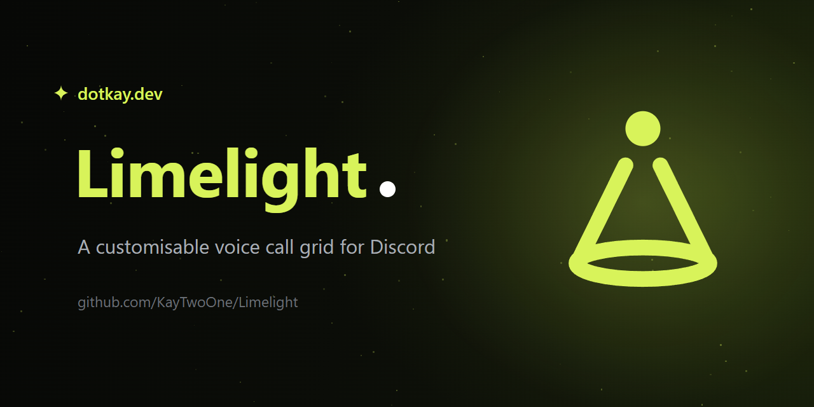
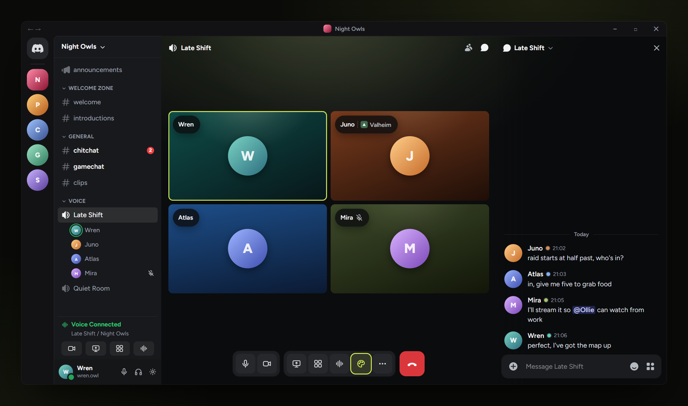
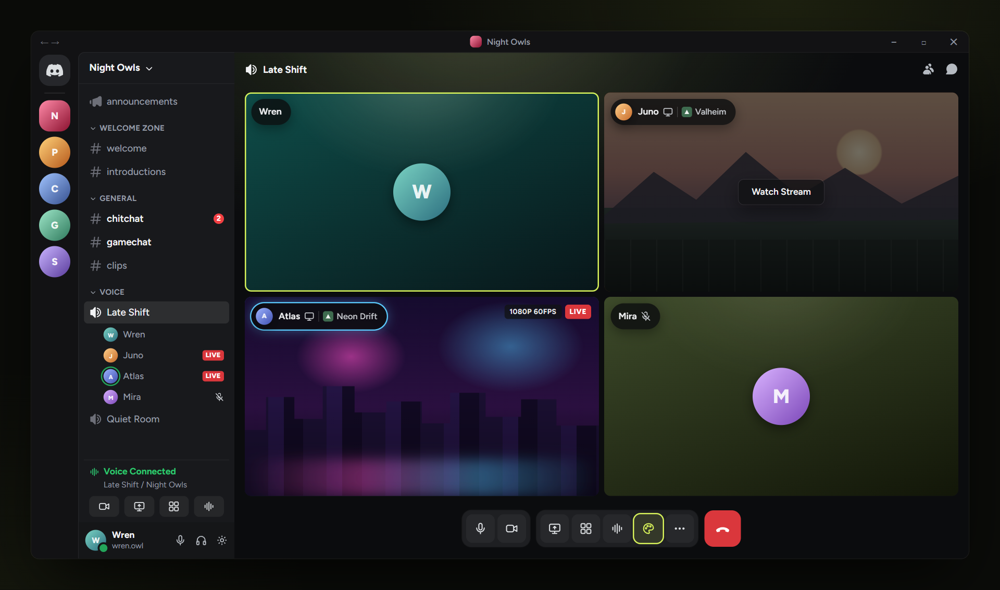
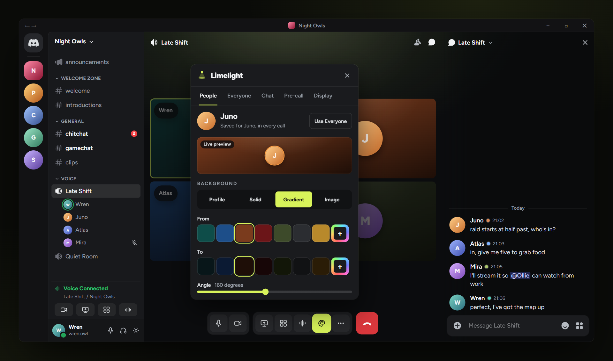
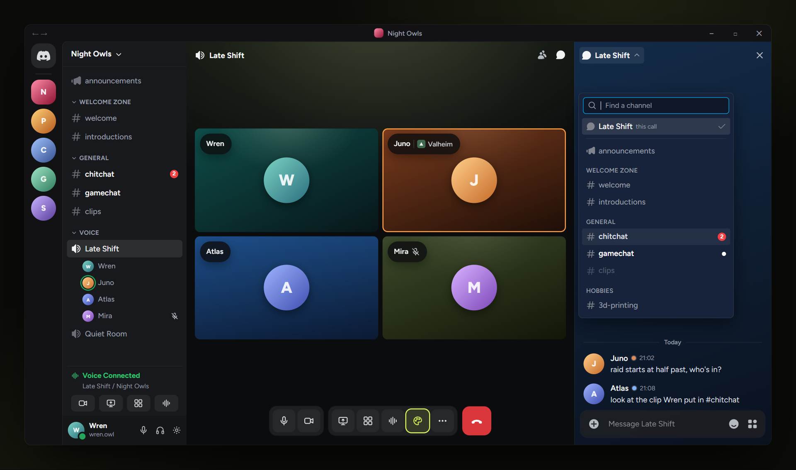
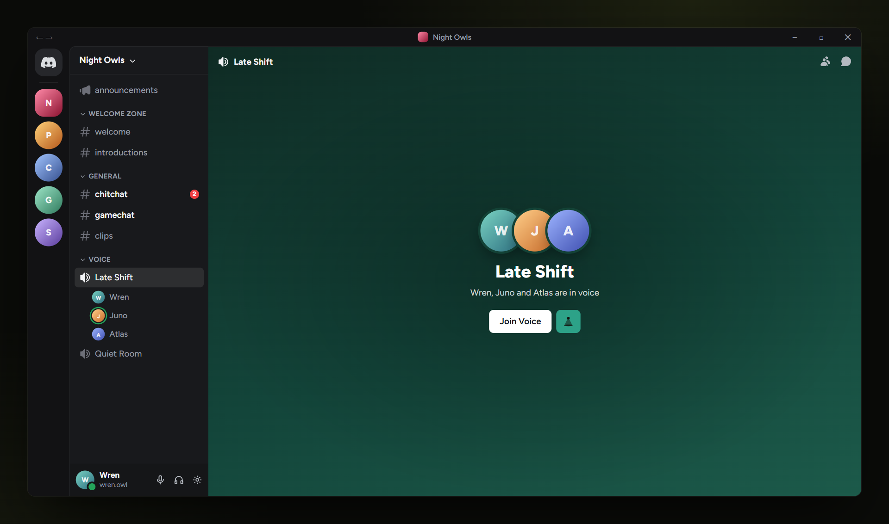

<div align="center">



**A customisable voice call grid for Discord.**

[](CHANGELOG.md)
[](https://vencord.dev)
[](#install)
[](LICENSE)

[Install](#install) · [Themes](#themes) · [Streams](#streams) · [The panel](#the-panel) · [Chat](#chat) · [Pre-call](#the-pre-call-screen) · [Changelog](CHANGELOG.md)

</div>

---

Give the people in your calls their own look, one at a time or all at once. Everyone
keeps one tile for the whole call, even while they stream. The call's chat can sit on
the same stage as the grid, and it can open any text channel in the server without
you leaving the call.

Out of the box your calls still look like Discord. Limelight adds a pill on every
tile and a palette button in the call controls, and colours stay as they are until
you change one.



## Highlights

- **A theme for each person, or one for everyone.** Pick a background (their profile
  colours, a solid colour, a gradient or your own image), an overhead spotlight and a
  speaking ring colour. A theme you give someone is saved and comes back whenever
  they're in a call with you.
- **One tile per person.** When someone goes live, their tile becomes their stream.
  Discord's extra "Watch Stream" preview tile is gone, so the grid doesn't reshuffle
  every time somebody starts or stops sharing.
- **A chat that joins the call.** The call chat can follow the grid's stage or wear a
  background of its own, with a dot beside each name in that person's tile colour.
- **Any channel, from the call.** The chat's title opens a picker of the server's text
  channels. Pick one and its live chat takes over the side panel while the call stays
  on screen.
- **The screen before you join.** The pre-call screen can take the same looks, with a
  Limelight button beside Join Voice that matches your theme.
- **Sized to the tile.** Pills, avatars and badges scale with each tile, so a call
  reads the same in a small window as it does full screen on an ultrawide.
- **Stays on your PC.** Themes and images are stored locally for your account.
  Limelight makes no network requests of its own.

## Themes

Every tile has three parts you can change.

| Part | Options |
| --- | --- |
| **Background** | **Profile** (their Discord profile colours, exactly as Discord shows them), **Solid**, **Gradient** (from, to and an angle) or **Image** |
| **Spotlight** | **Off**, **Soft** or **Bright**: a warm overhead light from the top of the tile |
| **Speaking ring** | Any colour. Discord's green by default |

The **Everyone** theme covers anyone without a theme of their own, and starts as
Profile with the spotlight off and Discord's green ring, which is why nothing changes
until you touch it. Colours come from a small curated set of swatches, and every row
ends in a custom swatch that opens a full picker with a hex field.

You pick images with the normal file picker. Limelight resizes them on your PC to fit
a tile and keeps them locally, and tidies away any image no theme uses any more.

## Streams



- **Live.** Their tile shows the stream greyed out behind a **Watch Stream** button,
  and their avatar slides into the front of their pill.
- **Watching.** The stream plays in full colour inside their tile, with Discord's own
  quality and LIVE badges and volume control. Click it again to maximise, as Discord
  does.
- **Maximised.** The pill shrinks to just the avatar when you're not hovering, so it
  stays clear of minimaps and HUDs. The filmstrip keeps one mini tile per person.
- **Several streams at once** each stay in their own tile, independent of each other.
- **Auto maximise livestream upon joining** (Display tab) sends Watch Stream straight
  to the maximised view if you prefer how Discord does it.

## The panel



The palette button sits in the call's control bar, beside the soundboard. It opens a
panel with five tabs:

| Tab | What it's for |
| --- | --- |
| **People** | Everyone in the call right now, with their current theme. Open someone to edit their theme; every other tile dims while you do, so you can see whose tile is changing. **Use Everyone** clears their own theme. |
| **Everyone** | The theme for anyone without one of their own. |
| **Chat** | How the call chat looks, how it joins the grid, theme dots and the channel picker. |
| **Pre-call** | The look of the screen you see before joining a voice channel. |
| **Display** | Grid zoom, tile corners and spacing, and two switches (below). |

Every change applies live to the real tiles and saves straight away. Escape, the close
button or the palette button closes it.

**Display settings**

| Setting | Options | Default |
| --- | --- | --- |
| Grid zoom | 50% to 150% | 100% |
| Tile corners | Sharp, Discord, Soft | Discord |
| Tile spacing | Tight, Normal, Airy | Normal |
| Disable all user themes | On or off: one calm dark grey for every tile | Off |
| Auto maximise livestream upon joining | On or off | Off |

The same controls are on Limelight's settings page, along with **Reset all Limelight
themes**.

## Chat



**Looks.** **Discord** leaves the chat exactly as it is. **Follow grid** puts the call
and the chat on one stage, tinted by the Everyone theme. **Own theme** gives the chat a
background of its own, with a scrim behind the text so messages stay readable.

**Joining the grid.** With Follow grid or Own theme, the chat can be **Seamless** (no
divider, it fades in from the stage), **As a tile** (a floating card with the grid's
corners) or **Line** (a thin divider, as Discord has it).

**Theme dots by names.** A small dot beside each person's name in that person's tile
colour, lightened where it needs to be to stay visible.

**Channel picker.** Click the chat's title to open it:

- The call's own chat is listed first, then the server's text and announcement
  channels in the same order as your channel list.
- Type to search, use the arrow keys and Enter, or just click.
- Unread dots and mention badges follow each channel's own notification setting, the
  same as your sidebar. Muted channels are dimmed, or hidden if you hide muted channels
  in that server.
- It only lists channels you can read and channels on your channel list in servers
  that use Channels & Roles. Forums and media channels aren't chats, so they're left out.
- A picked channel is Discord's own chat, so everything works as normal: profiles from
  names and mentions, replies, reactions, uploads, slash commands, and the gift, GIF,
  sticker and emoji buttons.
- **Call chat** in the header takes you back. Your pick stays for the rest of the call.
- A channel link clicked inside the panel opens there instead of taking you away from
  the call. Anywhere else, Discord handles it as usual.

Opening, closing, scrolling and sending always stay Discord's own. The picker can be
switched off in the Chat tab.

## The pre-call screen



Before you join, the pre-call screen can stay as **Discord** draws it, take the
**Follow grid** stage, or use a background of its **Own**. The Limelight button beside
Join Voice takes its colour from your theme and is contrast checked, so it never sinks
into the background or turns into a white block next to Join Voice. It opens the panel
on the Pre-call tab.

## Install

Limelight is a **userplugin**, compiled into the client mod from source. It's built
and tested on **[Equicord](https://github.com/Equicord/Equicord)**, and uses the same
plugin APIs as **[Vencord](https://vencord.dev)**.

**On Equicord:**

```console
git clone https://github.com/Equicord/Equicord
cd Equicord
pnpm install --frozen-lockfile
git clone https://github.com/KayTwoOne/Limelight src/userplugins/limelight
pnpm build && pnpm inject
```

**On Vencord** (same steps, different repo):

```console
git clone https://github.com/Vendicated/Vencord
cd Vencord
pnpm install --frozen-lockfile
git clone https://github.com/KayTwoOne/Limelight src/userplugins/limelight
pnpm build && pnpm inject
```

Quit Discord fully before `pnpm inject` (tray icon, then Quit). Afterwards enable
**Limelight** under Settings → Plugins and restart Discord once more.

**Already building from source with your own plugins?** Just the
`git clone … src/userplugins/limelight` line and a rebuild.

To update: `git pull` inside `src/userplugins/limelight`, then `pnpm build` and
`Ctrl+R` in Discord.

## How it works

- **Eight small webpack patches**, one per feature: tile classes and the pill, one
  tile per streamer, Watch Stream inside the tile, the stream tile's badge, the
  palette button, the pre-call screen, the call chat and channel links in it. Each
  one applies on its own, and the call chat's three replacements apply together or
  not at all, so a Discord update that breaks one costs only that feature.
- **Discord's grid is never replaced.** Discord still sizes and arranges the tiles;
  Limelight only styles what's inside them, so the call view always renders.
- **Every surface sits in an error boundary.** If any part of Limelight fails, Discord's
  own version of that element shows instead.
- **Storage is per account**, in your client's own IndexedDB. Every load rebuilds your
  settings from a list of known values, so a corrupt entry falls back to its default
  rather than breaking anything.
- **No network requests of its own.** Picking a channel in the call chat asks Discord
  for that channel's messages, the same request Discord makes when you open it
  yourself. Nothing runs on a timer.
- **Accessible.** Reduced motion turns every animation into an instant change, every
  control has a visible lime focus ring, and colour is never the only signal: names
  sit beside dots and badges carry text.

## Not in 1.0

- Reordering or resizing individual tiles.
- Sharing themes with other people. Your themes are only ever seen on your own client.
- Threads or other voice channels' chats in the channel picker.

## Brand

Limelight shares its look with [At a glance](https://github.com/KayTwoOne/at-a-glance):
the same dark stage, wordmark and white dot, with lime in place of magenta. The full
sheet is in [assets/brand.png](assets/brand.png), and the icon is
[assets/icon.svg](assets/icon.svg).

## License

[GPL-3.0](LICENSE), same as Vencord.
